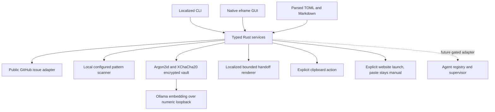

# ALI architecture

## Current component map

## Boundaries

- **CLI and GUI adapters:** `main.rs` and `gui.rs` collect explicit user actions. Both load one typed configuration and the selected required locale.
- **GitHub adapter:** `issue.rs` accepts HTTPS URLs for the configured host, uses the public API without credentials, disables proxy inheritance and redirects, and bounds comments/timeouts.
- **Prompt renderer:** `prompt.rs` renders the localized issue template and, when selected, appends the configured agent-specific localized Markdown agreement. Issue values are passed as data, not reparsed as template source. Agent profile ids and template completeness are validated at configuration load.
- **Model adapter:** `provider.rs` permits only credential-free numeric loopback HTTP endpoints, disables proxy inheritance and redirects, and sends content only after an explicit local-model action.
- **Embedding adapter:** `embedding.rs` calls the configured local Ollama API using a loopback IP and redirect-free client. Embeddings are derived sensitive data, not a redaction proof.
- **Memory vault:** `memory.rs` serializes user-selected text, optional configured-agent attribution, and vectors, derives a key using bounded Argon2id settings, authenticates/encrypts with XChaCha20-Poly1305, and atomically replaces the vault. The CLI prompts through hidden terminal input; the GUI uses a masked field and transfers a zeroizing passphrase value to its local worker. Passphrases are not stored. Entry, vault, list, and search-result bounds are parsed from `config/runtime.toml`. Agent tags are entered by the user; no agent activity is harvested.
- **Privacy scanner:** `privacy.rs` accepts only bounded UTF-8 text with configured extensions, rejects symlink inputs and existing outputs, applies parsed regular expressions and Luhn validation for payment-card candidates, and creates mode-0600 output.
- **Semantic privacy review:** `privacy analyze` compares bounded original-text segments with configured sensitivity descriptions in every supported locale. `privacy review` first applies configured lexical redaction in memory, then performs semantic analysis against the candidate and writes the local candidate only if the loopback analysis completes within its configured total duration. It emits segment/category cues only; it does not redact semantic content, certify release, or contact a remote model. The GUI runs this combined review in a worker thread.
- **Handoff:** `handoff.rs` accepts a strict JSON schema from stdin, validates identifier/field bounds, renders a locale template, scans known sensitive patterns, enforces a configured ceiling no greater than 50 lines, and writes a new mode-0600 file.
- **Agent catalogue:** `agents.rs` reports only executables declared in `config/agents.toml` whose paths are found. It does not verify versions/authentication or run agents. Automatic recovery remains a roadmap item.

## Data and network policy

User documents and memory are local by default. The current build has no remote model, embedding, agent, telemetry, or update client. Public GitHub issue retrieval is an explicit network action. Opening a website is an explicit user action; the user performs any paste manually. A local model or same-user process can still access its local inputs, so restricted data remains subject to the active local OS account and device security.

`config/runtime.toml` sets outbound default to `deny`, the maximum document size, locale policy, restricted profiles, memory KDF bounds, loopback model endpoints, storage identity, and accepted text types. `settings.rs` rejects invalid endpoints, missing locales, invalid templates, unsupported detector expressions, and security settings below minimums.

## Current gaps

The current build does not launch or fail over between agents, manage accounts, authenticate the GUI, parse PDFs/Office documents, run an OS sandbox, or provide signed installers. Agent path discovery alone is not a compatibility or safety assessment. The scanner can miss semantic or indirect identifiers; no automated scan establishes anonymity or legal privilege. See [security](SECURITY.md), [threat model](THREAT_MODEL.md), and [roadmap](ROADMAP.md).
